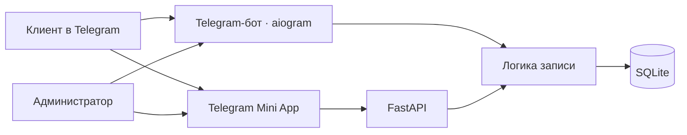

# Nail Atelier — Telegram-бот и Mini App для записи клиентов

<p align="center">
  
  
  
  
  
</p>

**Nail Atelier** — Telegram-бот и Mini App для онлайн-записи в студию маникюра и красоты. Клиенты выбирают услугу и время прямо в Telegram, а администратор управляет заявками, расписанием и услугами в боте и веб-панели.

От первого знакомства со студией до подтверждения визита — всё в одном пространстве, без отдельного приложения для клиента.

---

## 💅 Возможности

### Для клиента

* **Онлайн-запись в Mini App**: выбор услуги, конкретного или любого свободного мастера, даты и времени.
* **Свободные слоты** с учётом длительности процедуры, занятых записей и блокировок мастера.
* **Мои записи**: просмотр своих визитов и отмена с учётом правил студии.
* **Клиентское меню бота**: услуги и цены, информация о студии, контакты и переход к записи.
* **Уведомления в Telegram** при событиях записи.

### Для студии

* **Расписание и заявки**: просмотр, подтверждение, отмена и завершение визитов.
* **Ручная запись** клиентов и блокировка времени мастера для перерывов или других дел.
* **Услуги и цены**: настройка каталога и доступности услуг.
* **Мастера и данные студии**: управление через административную панель Mini App.
* **Назначение мастера** для заявок, где клиент выбрал любого свободного специалиста.

---

## 🛠 Технологический стек

| Слой | Технологии |
| :--- | :--- |
| **Telegram Bot** | `aiogram 3`, long polling, клиентские и административные команды |
| **Backend API** | `FastAPI`, `Uvicorn`, проверка Telegram `initData` |
| **Хранение** | `SQLite`, `aiosqlite`, асинхронный `SQLAlchemy` |
| **Mini App** | HTML, CSS, JavaScript, Telegram WebApp SDK |
| **Запуск и тестирование** | Windows launcher, мастер настройки, `pytest` |

---

## ⚡ Как устроена запись

### 1. 📱 Клиент выбирает услугу и время

Mini App проводит клиента по шагам: услуга → мастер → дата → свободный слот → контакты. Длительность услуги влияет на доступность времени в расписании.

### 2. 📋 Заявка попадает в расписание

Запись сохраняется в SQLite. Клиент может вернуться к ней во вкладке «Мои записи», а студия — открыть расписание и обработать заявку.

### 3. 👩‍💼 Студия управляет визитом

Администратор подтверждает или отменяет заявку, отмечает завершённый визит, создаёт запись вручную и блокирует занятые интервалы. Для некоторых действий доступны и Telegram-бот, и панель Mini App.

---

## 🏗️ Архитектура



| Каталог / файл | Назначение |
| :--- | :--- |
| `bot.py` | Запуск API и Telegram-бота |
| `api/` | Клиентские и административные API-маршруты |
| `core/` | Логика записи, модели, настройки и проверка доступа |
| `handlers/` | Обработчики команд и действий в Telegram |
| `miniapp/` | Интерфейс клиента и административная панель |
| `ui/` | Тексты, форматирование и клавиатуры бота |
| `tests/` | Автоматические тесты |

---

## 📦 Быстрый старт

### Вариант 1: Посмотреть демо на Windows

1. Установите Python и запустите **`run.bat`**.
2. В меню выберите **«Посмотреть пример записи»**.
3. Дождитесь открытия Mini App в браузере и пройдите запись на демонстрационных данных.

По умолчанию демо открывается по адресу `http://127.0.0.1:8080/miniapp/`. Чтобы остановить просмотр, вернитесь в консоль и нажмите Enter.

### Вариант 2: Подключить Telegram-бота

1. Создайте бота через [@BotFather](https://t.me/BotFather) и получите токен.
2. Подготовьте публичный **HTTPS-адрес**, ведущий к приложению.
3. Запустите `run.bat`, выберите **«Подключить своего бота»** и пройдите мастер настройки: токен, владелец и адрес приложения.
4. Настройте данные студии и выберите **«Запустить бота»**.

Токен сохраняется в локальном `.env`, настройки студии и список администраторов — в `config.json`. Данные студии и адрес `https://example.com` в исходной конфигурации демонстрационные: замените их перед подключением.

### Ручная установка и тесты

```powershell
git clone https://github.com/W1bbex/nail-booking-bot.git
cd nail-booking-bot
python -m venv .venv
.\.venv\Scripts\python.exe -m pip install -r requirements-dev.txt

# Запуск панели
.\.venv\Scripts\python.exe -u launcher.py

# Автоматические тесты
.\.venv\Scripts\python.exe -m pytest tests -q
```

При локальном запуске API-документация доступна по адресу `http://127.0.0.1:8080/docs`. Автоматические тесты не заменяют проверку работы с реальным Telegram и HTTPS-развёртыванием.

---

## 🤖 Команды бота

| Для клиента | Для администратора |
| :--- | :--- |
| `/start` — главное меню | `/admin` — панель управления |
| `/book` — онлайн-запись | `/schedule` — расписание |
| `/bookings` — мои записи | `/services_admin` — управление услугами |
| `/services` — услуги и цены | `/block` и `/unblock` — блокировки времени |
| `/about` и `/contact` — о студии и контакты | `/manual_book` — ручная запись клиента |

## 👤 Автор

* Разработчик: **W1bbex** ([@w1bbex](https://t.me/w1bbex))
* Сайт: [w1bbex.ru](https://w1bbex.ru)
* GitHub: [@W1bbex](https://github.com/W1bbex)
